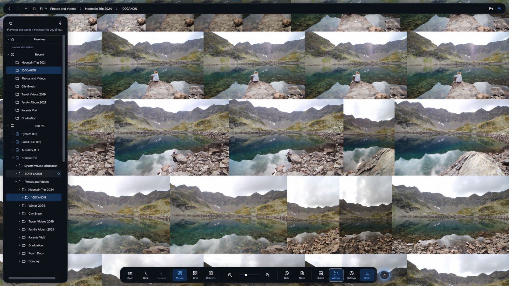
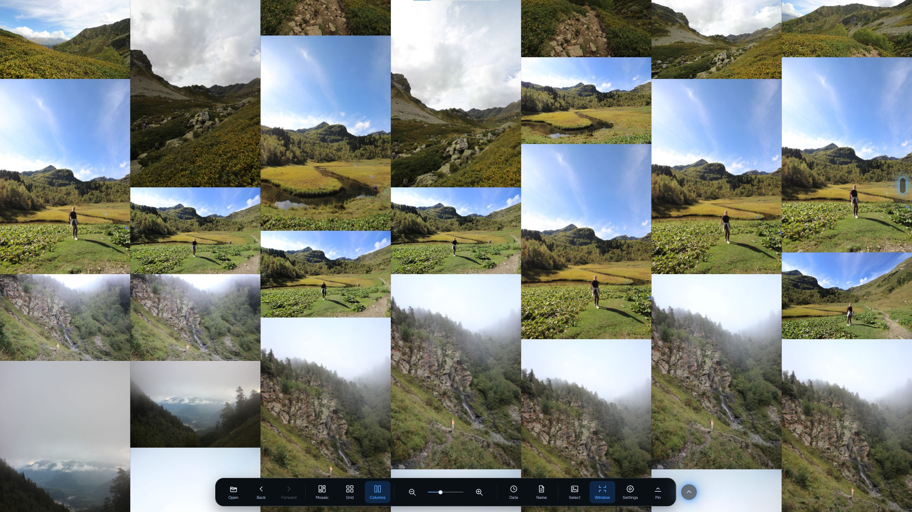
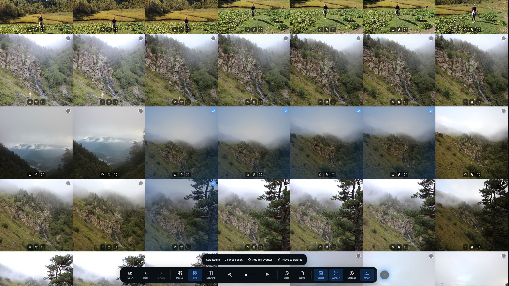
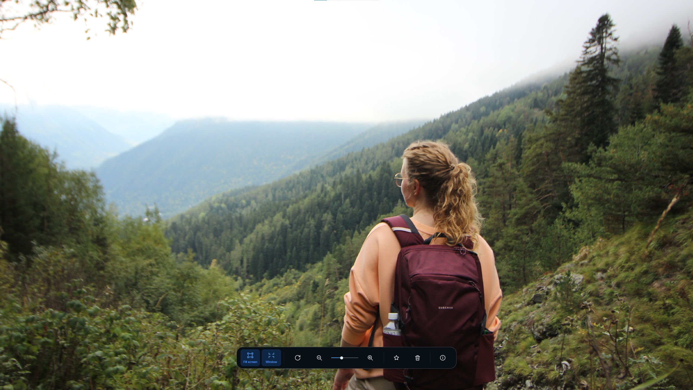
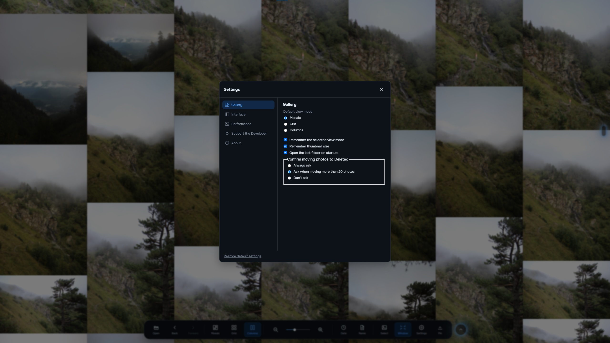
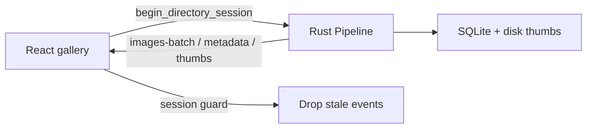

# StitchVue

[](https://github.com/PavelKull/StitchVue/actions/workflows/ci.yml)
[](https://github.com/PavelKull/StitchVue/releases/latest)
[](./LICENSE)

**High-performance Windows photo gallery for large local image libraries.**  
Built with **Tauri 2**, **Rust**, **React**, and **TypeScript**.

[**Download StitchVue v0.1.7**](https://github.com/PavelKull/StitchVue/releases/tag/v0.1.7) · [All releases](https://github.com/PavelKull/StitchVue/releases) · [Engineering notes](./docs/ENGINEERING.md)



StitchVue is built for folders with tens of thousands of photos: virtualized justified grid, background thumbnail pipeline with on-disk SQLite cache, session-safe folder switching, favorites (copies under a service folder), local trash, and an integrated viewer. Originals stay on disk where you put them; the app stores only cache and library metadata under `%LOCALAPPDATA%\StitchVue\`.

## Screenshots

**Justified columns layout**



**Multi-select in the grid**



**Integrated image viewer**



**Settings**



## Engineering highlights

These are the hard parts the UI alone does not show. Short walkthrough: [`docs/ENGINEERING.md`](./docs/ENGINEERING.md). Module map: [`docs/ARCHITECTURE.md`](./docs/ARCHITECTURE.md).

| Challenge | Approach |
|-----------|----------|
| Scroll tens of thousands of tiles without freezing the UI | Virtualized justified grid; only the viewport (plus a small overscan) mounts DOM nodes |
| Keep the UI responsive while decoding thumbnails | Rust background pipeline with prioritized workers; frontend batches `thumbnail-ready` updates |
| Avoid wrong images after fast folder switches | Monotonic directory `session` on both sides; stale IPC events are dropped (`directorySession`) |
| Survive reopen without re-decoding everything | SQLite-backed thumbnail cache keyed by path + size + mtime |
| Favorites without blocking the grid | Optimistic UI with rollback; file ops claim/complete on the Rust side |



## Features

- **Browse** — open a folder and scroll large collections with virtualization and session-safe updates when you switch directories.
- **Thumbnails** — background pipeline with prioritized decoding and SQLite-backed thumbnail cache on disk.
- **Favorites** — copy selected images into a managed favorites area with optimistic UI and undo-friendly flows.
- **Local trash** — move files to an app-managed trash instead of immediate permanent deletion (restore supported).
- **Viewer** — open images from the grid in an integrated viewer.

## System requirements (Windows)

- **OS:** Windows 10 or later (64-bit)
- **Runtime:** [Microsoft Edge WebView2](https://developer.microsoft.com/microsoft-edge/webview2/) (usually already installed on current Windows; the installer may bundle it if needed)
- **Architecture:** x64

## Install

1. Open the latest release: [**v0.1.7**](https://github.com/PavelKull/StitchVue/releases/tag/v0.1.7) (or [Releases](https://github.com/PavelKull/StitchVue/releases)).
2. Download the **NSIS** setup executable (`.exe`).
3. Run the installer and launch StitchVue from the Start menu.

After a signed GitHub Release is published as **Latest** (with `latest.json` and `.sig`), the app can check for updates on launch and from **Settings → About → Check for updates**. Installation starts only after you click **Update**.

## Report bugs

- **In the app:** Settings → About → open the GitHub issues link.
- **On GitHub:** [New issue](https://github.com/PavelKull/StitchVue/issues/new).

Please include Windows version, app version, and steps to reproduce when you can.

Maintainer working journal (not a release QA checklist): [`docs/stabilization/BUGS.md`](./docs/stabilization/BUGS.md).

## App data (not your photos)

StitchVue keeps cache and databases under:

```text
%LOCALAPPDATA%\StitchVue\
```

Typical contents include the thumbnail cache and `stitchvue.db` (library paths, cache index, and related metadata). **User photo files are not stored here** unless you explicitly use favorites or local trash features that copy or move files within your library layout.

## Run (development)

```text
npm install
npm run tauri dev
```

The first launch compiles Rust and can take several minutes. Checks used in CI: `npm run typecheck`, `npm test`, `cargo test --manifest-path src-tauri/Cargo.toml --locked`.

## Documentation

| Doc | Purpose |
|-----|---------|
| [`docs/ENGINEERING.md`](./docs/ENGINEERING.md) | Portfolio-oriented case study (problems → decisions → how to verify) |
| [`docs/ARCHITECTURE.md`](./docs/ARCHITECTURE.md) | Module map and data flows |
| [`docs/INVARIANTS.md`](./docs/INVARIANTS.md) | Business invariants |
| [`docs/IPC.md`](./docs/IPC.md) | Tauri commands and events |
| [`docs/DEVELOPMENT.md`](./docs/DEVELOPMENT.md) | Scripts, layout, tests |

## License

MIT — see [`LICENSE`](./LICENSE).

## Releases (maintainers)

Closed testing and public release steps: [`docs/release/RELEASING.md`](./docs/release/RELEASING.md). Tag pushes (`v*`) run the [release workflow](./.github/workflows/release.yml); every PR/push to `main` runs [CI](./.github/workflows/ci.yml).
