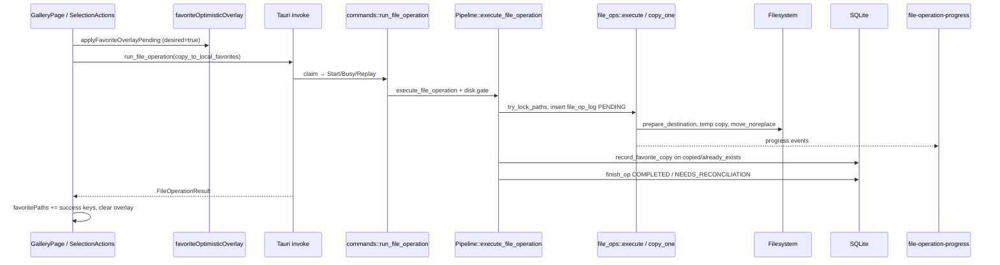
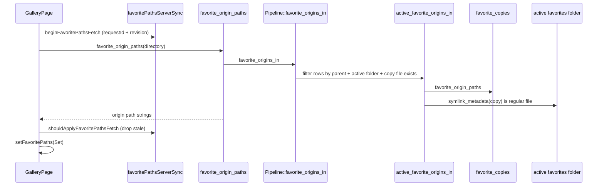
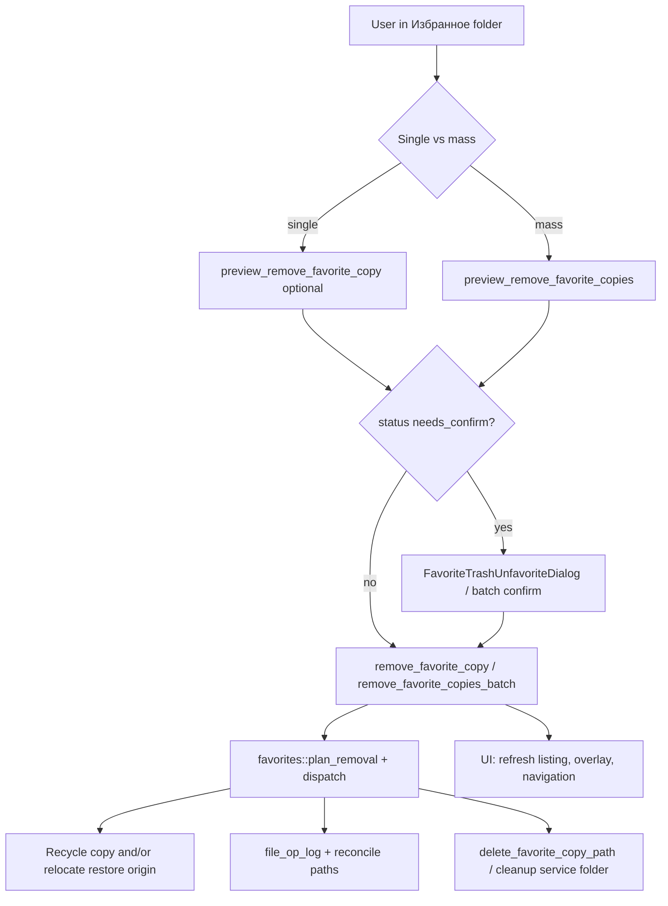

# Favorites — architecture (as implemented)

Photo favorites = **copy** of originals into a per-album service folder `Избранное` (alt leaf `Избранная`), marked with `.stitchvue.role` = `favorites`. Stars in the parent album reflect origins whose **active** copy file exists on disk.

## End-to-end chain (add star)

**Evidence:** `GalleryPage.tsx` (~1891–2064), `pipeline/mod.rs` (`execute_file_operation`, `record_operation_links`), `file_ops/mod.rs` (`execute`, `copy_one`).

## End-to-end chain (stars listing)

**Evidence:** `favorites.rs` (`active_favorite_origins_in`), `GalleryPage.tsx` (~1544, 2545).

## End-to-end chain (remove copy / unfavorite)

**Evidence:** `favorites.rs` (`Plan`, `ConfirmKind`, `dispatch_removal_plan`), `GalleryPage.tsx` (unfavorite handlers ~2569+), `FavoriteTrashUnfavoriteDialog.tsx`.

## IPC surface (photo favorites)

| Command | Role |
|---------|------|
| `run_file_operation` | Add copies (`copy_to_local_favorites`) |
| `favorite_origin_paths` | List starred origin paths for open album |
| `favorite_origins_for_copies` | Map copy paths → origin (batch) |
| `preview_remove_favorite_copy` / `remove_favorite_copy` | Unfavorite one file |
| `preview_remove_favorite_copies` / `remove_favorite_copies_batch` | Batch unfavorite |
| `undo_favorite_removal` / `discard_favorite_undo` | **Stub** (see FAILURE_RECOVERY) |
| `rename_folder` | Rewrites SQLite paths when favorites folder renamed |
| `remove_empty_service_folder` / `cleanup_empty_service_folder` | Purge DB under removed service path |

**Not photo copy favorites:** `toggle_favorite`, `favorite_folders` → `library/mod.rs` + `favorite_folders` table.

## Concurrency and locking

- **In-process path locks:** `try_lock_paths` during `execute_file_operation` (sources + album + destination). Conflicting ops return error string (`locks.rs`).
- **Operation claim:** `file_ops::claim` / `complete` / `abandon` for duplicate `operation_id` (Replay/Busy).
- **UI:** `unfavoriteGate` blocks parallel unfavorite; favorite add blocks duplicate pending overlay per path (`GalleryPage`).

## Watcher / external FS

- `folder-changed` pipeline event can trigger gallery refresh (`galleryPipelineEvents.ts`). **CODE-SUPPORTED:** no dedicated favorites reconcile on arbitrary external edits; stars re-derived on next `favorite_origin_paths` + copy existence check.

## Session semantics

- Directory `requestId` filters pipeline events (`directorySession.ts`). File operations are **not** tagged with gallery session in IPC; stale results discarded when `result.directory` ≠ current view (`GalleryPage` ~1945–1954).
