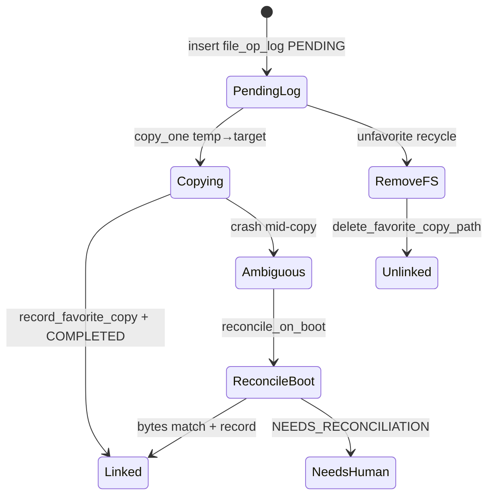

# Favorites — failure & recovery (as implemented)

## Mechanisms that exist

### 1. `file_op_log` + `reconcile_on_boot`

**Trigger:** Pipeline startup (`reconcile_on_boot`).

**Add favorites (`OP_ADD_TO_FAVORITES`):** `reconcile_add_to_favorites` compares source/copy on disk vs row; may complete link, mark `ST_NEEDS_RECONCILIATION`, or `ST_COMPLETED` if snapshot already matches (`reconcile.rs` ~57–111).

**Remove favorites (`OP_REMOVE_FROM_FAVORITES`):** If copy gone → delete DB row + `ST_COMPLETED`; if copy still present → `ST_FAILED` (~151–166).

**Evidence:** `favorites_trash_lifecycle_final.rs` CP1–CP4; `favorites_copy_recovery.rs` (10 tests).

### 2. Pending destination journal

During copy, destination path written to `file_op_log` before irreversible IO completes (`update_pending_destination` via journal in `execute_file_operation`). Enables reconcile after crash mid-copy.

### 3. `ST_NEEDS_RECONCILIATION`

Used when FS and SQLite disagree after add link failure or ambiguous reconcile (`record_operation_links` favorite_link error; reconcile messages).

**User-visible:** **UNVERIFIED** — no dedicated UI surface found for reconciliation queue; status lives in DB.

### 4. Removal dispatch + reconcile retry

Fault-injection tests simulate FS before SQLite / pending journal (`FAVORITES_TRASH_LIFECYCLE_FINAL_REPORT.md`). `reconcile_on_boot` re-entrant on CP4.

### 5. Temp file cleanup

`copy_one` uses `TempFile` guard dropping partial temp on failure (`file_ops/mod.rs`).

## Mechanisms that do NOT exist (or stubbed)

| Claim | Evidence |
|-------|----------|
| In-app undo of unfavorite | `Pipeline::undo_favorite_removal` returns error directing user to Windows Recycle Bin (`pipeline/mod.rs` ~1322–1324) |
| `discard_favorite_undo` | No-op `Ok(())` (~1326–1328) |
| `favorite_undo` table active path | Legacy recovery only on boot (`recover_legacy_undo`) |
| Atomic FS+SQLite transaction | Constitutionally separate; reconcile bridges gaps |
| Automatic orphan `favorite_copies` GC | Not on star listing |

## Partial completion

| Scenario | Behavior | Evidence |
|----------|----------|----------|
| Multi-file add, some fail | Per-outcome status in one `FileOperationResult`; UI updates stars only for successes | `GalleryPage` ~2020–2062 |
| Batch unfavorite partial | Per-path results; `summarizeUnfavoriteBatch` | `removeFavoritesBatch.ts` |
| Batch invoke total failure | `catch` may mark all work failed (**CODE-SUPPORTED**, report residual risk) |
| Link record fails after copy | File on disk; `ST_NEEDS_RECONCILIATION` | `record_operation_links` |

## Crash timing matrix (high level)

## SQLite errors

DB methods return `Result<_, String>`; propagate to IPC as command error strings. **CODE-SUPPORTED:** no automatic retry layer for SQLITE_BUSY in favorites paths (not verified exhaustively).

## Stale UI events

- Wrong directory: favorite add clears overlay without updating paths (`GalleryPage` ~1945–1954).
- Stale `favorite_origin_paths`: `shouldApplyFavoritePathsFetch` (**VERIFIED** — `favoritePathsServerSync.test.ts`).
- Mass unfavorite session: gate `sessionId` checks (**CODE-SUPPORTED** — limited automated test per final report F11).

## Recovery assumptions (audit stance)

Per constitution v1.1.0: **do not assume** user-visible recovery for `NEEDS_RECONCILIATION` until product spec confirms. Boot reconcile is **CODE-SUPPORTED** with CP tests for remove/restore journals; add-favorites reconcile has tests in `reconcile.rs` / `favorites_copy_recovery.rs`.
