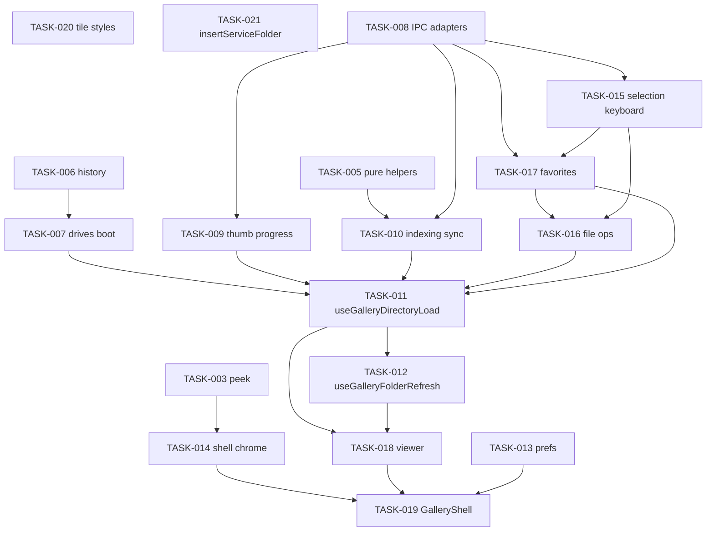

# GalleryPage — план декомпозиции FSD 2.0

Документ подготовлен architecture-coordinator (read-only). Синтез: анализ `GalleryPage.tsx`, существующих срезов `src/features/**`, `src/widgets/**`, `docs/ARCHITECTURE.md`, `docs/IPC.md`, задач `TASK-2026-001`…`004`, целевых инвариантов (`docs/INVARIANTS.md`) и read-only отчётов [frontend-decomposition](d21fc4b5-1b8d-453b-8dfd-7302ea7a5363), [backend-decomposition](ab3dc4b6-aeb9-47e9-84a8-ef7c2d843710), [code-auditor](11debf71-47bc-439b-a1aa-585a53c18f09), [regression-guardian](ba1e1934-4e49-4474-869c-ca0da82be9f3).

**Ограничения плана:** без изменения UX/UI, Rust, IPC-контрактов, алгоритмов thumbnail pipeline и семантики файловых операций. Исполнение — отдельные TASK-контракты (не `approved`).

**Статус:** rev. 3 — roadmap **утверждён** пользователем (2026-03-16). См. §1.1.

### 1.1 Утверждённые архитектурные решения

| # | Решение |
|---|---------|
| 1 | Порядок срезов orchestration: **TASK-015 → TASK-017 → TASK-016 → TASK-011** |
| 2 | **TASK-017 и TASK-011 не параллелить** (один исполнитель / один dirty `GalleryPage.tsx`) |
| 3 | В roadmap входят **TASK-020** (стили tile) и **TASK-021** (`insertServiceFolder`); всего **TASK-005…021** (17 задач) |
| 4 | **Без React Context** для `requestId`, `viewRef` и прочих refs — только явный wiring на `GalleryPage` |
| 5 | **`load` и `refreshFolder` — разные ответственности** (TASK-011 только `load`; TASK-012 — `refresh`). Общий код — только при подтверждённом дублировании, не «универсальный coordinator» |
| 6 | Shell `mousemove` / sidebar peek — **`useGalleryShellPointerRouting`** (TASK-014); **не** сливать listeners с `useGalleryPanelPeek` без отдельного ТЗ |
| 7 | Тесты hooks с IPC: **mock Tauri** по образцу изолированных unit-тестов (`useGalleryScrollActivity.test.ts` — чистые helpers; для `invoke` — mock с **сбросом между тестами**) |
| 8 | Стили shell/tile (**TASK-020**) — отдельно, **без изменения визуала** |
| 9 | IPC, Rust, файловые операции, **алгоритмы загрузки/очереди миниатюр** — вне декомпозиции |

---

## 1. Executive summary

`GalleryPage.tsx` (~4843 строк) остаётся **единым оркестратором** главного экрана: сессия каталога, pipeline, избранное, selection/file ops, viewer, chrome и композиция виджетов. Уже вынесены пилоты **001–004** (чистые хелперы, peek, scroll chrome). В странице по-прежнему **~27 независимых ответственностей**, **~30 `useEffect`** (плюс `useLayoutEffect` fullscreen), **~30 прямых `invoke`** в page (ещё 6 событий в `useGalleryPipelineEvents`), **~100+ sync ref↔state**, плотная сеть `useRef` для порядка выполнения и гонок сессий.

**Цель декомпозиции:** `GalleryPage` как **композиция виджетов + тонкая координация сценариев**, бизнес-логика в `features/*`, крупный UI в `widgets/*`, IPC — в узких адаптерах (существующие `selectFolder`, `galleryPipelineEvents`, без новых контрактов).

**Объём roadmap:** **17 задач** `TASK-2026-005`…`021` после завершённых 001–004. Наибольший риск: **`load()` / `requestId` spine (последний крупный срез)**, **избранное (batch/unfavorite) до выноса load**, **file operations**, **связка indexing ↔ geometry ↔ session**. **Порядок исполнения:** orchestration избранного и file ops **до** переноса `load()` ([code-auditor](11debf71-47bc-439b-a1aa-585a53c18f09) F-05, F-06).

**Не делать:** один `useGalleryPage` на тысячи строк; универсальные менеджеры; перенос gallery-specific логики в `shared`.

---

## 2. Текущая архитектура GalleryPage

### 2.1 Позиция в FSD

| Слой | Факт | Проблема |
|------|------|----------|
| `pages/gallery` | `GalleryPage.tsx` + `ttlPreset.ts`, `indexingPathEquality.ts`, SCSS | Страница = god-component + оркестратор IPC |
| `widgets/*` | Сетка, sidebar, viewer, bars, dialogs | Получают десятки props/callbacks с page |
| `features/gallery` | 50+ модулей (order, pipeline events, peek, scroll…) | Часть сценариев всё ещё только в page |
| `features/favorites`, `selection` | Pure + тесты | Оркестрация optimistic/batch остаётся в page |
| `entities/*` | Типы folder/image | Используются корректно |

Точка входа подтверждена в `docs/ARCHITECTURE.md`: `main.tsx` → `App.tsx` → `GalleryPage`.

### 2.2 Уже извлечённое (TASK-001–004)

| TASK | Модуль | Что ушло из page |
|------|--------|------------------|
| 001 | `pages/gallery/ttlPreset.ts` | TTL preset для settings/cache UI |
| 002 | `pages/gallery/indexingPathEquality.ts` | `samePathList` / `samePathSet` для indexing guards |
| 003 | `features/gallery/useGalleryPanelPeek.ts`, `topNavPeekGeometry.ts` | Peek top/toolbar (часть shell handlers осталась в JSX) |
| 004 | `useGalleryScrollActivity`, `useGalleryScrollJump`, `galleryScrollJump`, `useGalleryBottomOverlayReserve` | Scroll jump, `set_scrolling`, bottom reserve |

**Сознательно не введён** фасад `useGalleryScrollChrome` (004) — сохранить для следующих срезов.

### 2.3 Внешние зависимости страницы

- **Tauri `invoke`:** `begin_directory_session`, `browse` (через `browseDirectory`), `start_indexing`, `reorder_indexing`, `set_visible_range`, `set_geometry_range`, `set_scrolling` (в hook), `set_viewer`, `run_file_operation`, `cancel_file_operation`, favorites/trash команды, `cache_usage`, `clear_cache`, `remember_folder`, `set_storage_profile`, `directory_accessible`, и др.
- **События:** `useGalleryPipelineEvents` (`galleryPipelineEvents.ts`) — `metadata-batch`, `thumbnail-ready`, `images-batch`, `file-operation-progress`, `folder-changed`, …
- **Локальное хранилище:** `settingsPreferences`, `gallerySessionMemory`, `panelMemory`

---

## 3. Карта ответственностей

Ниже — **27 независимых ответственностей** (не считая чистый JSX-рендер). Для каждой: владелец, ключевые символы, файлы.

| # | Ответственность | Состояние / refs | Функции / эффекты | Зависимости |
|---|-----------------|------------------|-------------------|-------------|
| R1 | Локализация заголовка «Этот компьютер» | `view` | `useEffect` L299–307 | i18n |
| R2 | Bootstrap приложения | `bootNotice`, `pipelineListenersReady` | `useEffect` L849–888 | `load`, drives, prefs |
| R3 | Список дисков | `drivesState`, `drivesRequestRef` | `refreshDrives`, bootstrap | `listDrives` |
| R4 | Навигация по каталогу / история | `history`, `historyRef` | `load`, `goHistory`, `recordHistory` L4751+ | selection reset |
| R5 | **Сессия каталога и `load()`** | `requestId`, `view`, `status`, `error` | `load` L1269–1471, `begin_directory_session` | hot cache, indexing, scroll reset |
| R6 | Hot folder cache | — | `stashOpenFolder`, `recallHotFolder` в `load` | `folderHotCache.ts` |
| R7 | **Refresh listing без смены сессии** | `folderListingBusy`, `scrollRestore` | `refreshFolder` L2528+ | browse, viewer index |
| R8 | Pipeline events (подписки) | `metaRef`, `thumbsRef`, versions | `useGalleryPipelineEvents` L1614 | `directorySession.ts` |
| R9 | Thumb progress / pending UI | `folderThumbnailsPending`, thumb refs | `beginFolderThumbProgress`, poll L1688–1716 | `folderThumbnailsPending.ts` |
| R10 | Indexing / geometry nudge | `indexedPathsRef`, `geometryNudgeSessionRef` | effects L1642–1677, L1718–1732 | `galleryGeometryGate`, `indexPayload` |
| R11 | Viewport IPC (visible/geometry) | — | `reportVisible`, `reportGeometry`, `reportGeometryRange` | grid viewport ref |
| R12 | Сортировка и ordered list | `gallerySort` | `orderedImages` useMemo, `reorder_indexing` | `galleryOrder.ts` |
| R13 | Selection + keyboard command map | `selection`, `selectionMode`, `commandsRef` | `toggleAt`, `extendAt`, `commandsRef.current` L2080+ | `selection/*` |
| R14 | **File operations** | `fileOperation`, `fileProgress`, `confirmMove` | `runFileAction` L2273–2526 | optimistic favorites, photo flip |
| R15 | **Favorites paths sync** | `favoritePaths`, overlay maps | effects L1855–1895, `fetchFavoriteOriginPaths` | IPC `favorite_origin_paths` |
| R16 | **Mass unfavorite / gate** | `unfavoriteGateRef`, batch refs | `releaseUnfavoriteGate`, batch flows L2974+ | `removeFavoritesBatch`, `unfavoriteGate` |
| R17 | Favorites copy-origin cache | refs cache scope | effect L1896–1950 | `favoriteMassUnfavoriteOptimistic` |
| R18 | Trash UX | `restorePrompt`, `trashOriginPath` | effects L1811–1839, restore flows | `trashApi` |
| R19 | **Image viewer** | `viewerIndex`, pace refs | effects L1997–2051, preload | `viewerPreload`, `set_viewer` |
| R20 | Hover prefetch | `hoverRef` | effects L1164–1175, sidebar/grid callbacks | `galleryHover`, `hoverPrefetch` |
| R21 | Gallery chrome peek (остаток) | shell `onMouseMove`/`Leave` L4240+ | дублирует часть 003 для sidebar peek + topNav в shell | `useGalleryPanelPeek` |
| R22 | Scroll chrome (wiring) | `scrollTopRef`, `scrollRestore` | hooks 004, reset в `load` L1313–1316 | shared ref с folder header |
| R23 | Sidebar layout morph | `sidebarLayoutWidthFreeze` | effects L1104–1137, `toggleSidebarPin` | SCSS data-attrs |
| R24 | Panel / zoom persistence | `preferences`, rows, layout | effects L1084–1153 | `panelMemory`, session memory |
| R25 | Fullscreen | `useAppFullscreen`, `fsLayoutFreeze` | layout effect L1060–1076 | `app-fullscreen` feature |
| R26 | Settings / cache usage | `settingsOpen`, `usage` | `refreshUsage`, `clearCache` | SettingsDialog widget |
| R27 | Folder service animations | `folderExitingKey`, `photoFlip` | `beginFolderExitAnimation`, `addServiceFolderToView`, `applyRemovedServiceFolder` | folder tile flip |

**Связанные кластеры состояния (нельзя разрывать без контракта):**

1. **Session cluster:** `requestId` ↔ `load` ↔ `begin_directory_session` ↔ pipeline events ↔ thumb progress session ↔ `scanFolderRef`.
2. **Listing cluster:** `view` ↔ `orderedImages` ↔ `indexedPathsRef` ↔ `start_indexing` / `reorder_indexing`.
3. **Favorites cluster:** `favoritePaths` ↔ `favoriteOverlay` ↔ `fileOperation` ↔ mass unfavorite refs ↔ folder hide overlay.
4. **Selection/target cluster:** `selection` ↔ `viewerIndex` ↔ `currentTargets` ↔ `runFileAction`.
5. **Scroll cluster:** `scrollTopRef` ↔ folder header morph ↔ `scrollRestore` ↔ `load` reset.

---

## 4. Проблемы FSD и связанности

| Проблема | Доказательство | Рекомендация |
|----------|----------------|--------------|
| Page владеет бизнес-оркестрацией | `runFileAction`, mass unfavorite, `load` | Вынести в `features` hooks с явным API |
| IPC размазан по page | ~30× `invoke` в `GalleryPage.tsx` + listeners в hook | Тонкие adapters в `features/gallery/ipc/` (или `api/`) по доменам; не дублировать `listen()` |
| Widget → page styles | `FolderViewTile.tsx` → `GalleryPage.module.scss` | TASK-2026-021: colocate стили в widget |
| Widgets получают «листья» домена | `FolderSidebar` + 15 props | Промежуточный widget `GalleryShell` / сценарные hooks |
| Дублирование peek-логики | Shell handlers L4240–4303 vs `useGalleryPanelPeek` | TASK: вынести sidebar peek + shell mouse routing |
| `features` импортирует не page | OK сейчас | При выносе не тянуть `pages` вниз |
| `directorySession.ts` минимален | Только filter helpers | Оставить; сессию не раздувать |
| Циклических импортов page ↔ features | Не обнаружено | Сохранять: публичные `index.ts` срезов |

**Нарушение FSD (критичное):** бизнес-сценарии (избранное, ФС, load) на слое `pages` вместо `features`.

**Нарушение (мягкое):** page-specific хелперы (`indexPayload`, `insertServiceFolder`) в том же файле, что UI — допустимо до выноса в `features/gallery` / `features/folder`.

### 4.1 Подтверждённые риски (синтез code-auditor)

| ID | Риск | Суть | Действие в roadmap |
|----|------|------|-------------------|
| F-02 | **high** | Два канона порядка: `view.images` vs `orderedImages`; `targetFiles` vs `currentTargets()` | TASK-016: единый `selectTargets(orderedImages, …)` |
| F-03 | medium | Массовое зеркалирование ref↔state | Coordinators: `{ state, refs }` одним модулем |
| F-05 | **high** | Mass-unfavorite в page; тесты зеркалят page, не API hook | TASK-017 + тесты на extracted API |
| F-06 | **high** | `requestId` только в `load` | TASK-011 **после** 015–017; явный session owner |
| F-07 | medium | `refreshFolder` viewer index vs merged images | TASK-012: `sortPhotos(mergedImages)` |
| F-08 | medium | Нет тестов цепочки page | Contract-тесты hooks, не монолит page |

### 4.2 Смежные границы (backend-decomposition)

- **Session triple-sync:** `requestId` ↔ `begin_directory_session` ↔ payload событий — не менять порядок без guardian.
- **Listener bootstrap:** `pipelineListenersReady` до первого `load()` (L875–878).
- **Favorites undo:** `discard_favorite_undo` при unmount/navigation — сохранить в coordinator.
- **Две модели избранного:** sidebar bookmarks (`FolderSidebar` IPC) vs photo copies (page) — не смешивать в одном adapter без ТЗ.

---

## 5. Карта состояний и useEffect

### 5.1 Сводка

- **`useState`:** ~35 фрагментов (включая составные объекты).
- **`useEffect`:** 30 (L299, 849, 890, 898, 904, 1078, 1084, 1092, 1098, 1112, 1139, 1145, 1151, 1155, 1164, 1175, 1177, 1642, 1688, 1718, 1736, 1760, 1811, 1819, 1850, 1855, 1896, 1951, 1997, 2046).
- **`useLayoutEffect`:** fullscreen freeze L1060–1076.

### 5.2 Группы эффектов

| Группа | Строки | Независимость | Побочные эффекты |
|--------|--------|---------------|------------------|
| i18n title | 299 | Да | `setView` |
| Bootstrap | 849–888 | Монтирование | IPC, `load` |
| Boot notice timer | 890 | Да | timer |
| Fullscreen chrome | 904–1058 | С fullscreen | DOM classes |
| Fullscreen layout freeze | 1060 | С fullscreen | layout measure |
| Viewer → sidebar peek | 1078 | С viewer | UI |
| Persist zoom/layout/panels | 1084–1153 | prefs flags | localStorage |
| Sidebar morph | 1112–1137 | UI animation | timers |
| Window resize sidebar | 1155 | Да | listener |
| Hover context | 1164–1175 | sort/zoom/path | hover controller |
| Hover dispose | 1175 | unmount | dispose |
| File progress delay | 1177 | file op | timer |
| Geometry nudge indexing | 1642–1677 | **Order-sensitive** | `start_indexing` |
| Pipeline stats poll | 1688–1716 | thumb loading | interval |
| Reorder indexing | 1718–1732 | sort/path | `reorder_indexing` |
| Viewer index sync on sort | 1736–1747 | order stamp | setViewerIndex |
| Selection diag | 1760–1783 | debug | — |
| Trash selection lock | 1811 | trash role | reset selection |
| Trash origin lookup | 1819 | properties | IPC |
| Viewer path ref | 1850 | viewer | ref |
| Favorite paths fetch | 1855–1895 | path, fileOp | IPC |
| Copy origins in favorites folder | 1896–1950 | favorites listing | IPC |
| Fav diag install | 1951 | dev | global |
| Viewer IPC + preload | 1997–2044 | **Order-sensitive** | `set_viewer` |
| Neighbor thumbs | 2046 | thumb version | notify |

### 5.3 Порядок, критичный при переносе

1. **`pipelineListenersReady` до `load` в bootstrap** (L875–878).
2. **`begin_directory_session` до browse/indexing** в `load` (L1311+).
3. **`scrollTopRef` reset + `resetScrollActivityForFolderChange` сразу после session** (L1313–1316) — зафиксировано в TASK-004.
4. **Индексация после stable listing** (`start_indexing` в конце успешного `load` L1436+).
5. **Favorite paths effect зависит от `fileOperation`** (L1895) — сброс/ресинк после операций.

---

## 6. Целевая архитектура FSD 2.0

### 6.1 Роль `GalleryPage` после декомпозиции

```tsx
// Целевой скелет (псевдокод, не API-контракт). Без React Context — refs передаются явно.
export function GalleryPage() {
  const directoryLoad = useGalleryDirectoryLoad(); // load, view, session (TASK-011)
  const directoryRefresh = useGalleryFolderRefresh(directoryLoad.refs); // TASK-012, отдельный hook
  const thumbs = useGalleryThumbProgress(directoryLoad.session);
  useGalleryPipelineEvents(/* refs from directoryLoad + thumbs */);
  const favorites = useGalleryFavoritesCoordinator(directoryLoad);
  const selection = useGallerySelectionCoordinator(directoryLoad);
  const fileOps = useGalleryFileOperations({ directoryLoad, favorites, selection });
  const viewer = useGalleryViewerCoordinator(directoryLoad);
  const chrome = useGalleryChrome({ directoryLoad, viewer, selection });

  return (
    <GalleryShell chrome={chrome} directoryLoad={directoryLoad} ...>
      <GalleryMainStage ... />
      <FolderSidebar ... />
      <TopNavigationBar ... />
      <BottomControlBar ... />
      <GalleryOverlays viewer fileOps favorites settings ... />
    </GalleryShell>
  );
}
```

**Принципы:**

- Координаторы — **несколько предметных hooks** (5–7), каждый с узким возвращаемым типом.
- `GalleryPage` только **связывает** координаторы (например, `fileOps` нужен `directory.viewRef`).
- IPC только внутри hooks/adapters, не в JSX.

### 6.2 Подсистемы — владельцы до/после

| Подсистема | Сейчас | После | Риск |
|------------|--------|-------|------|
| Directory session / load | Page `load`, `requestId` | `useGalleryDirectoryLoad` (TASK-011) | **high** |
| Directory refresh | Page `refreshFolder` | `useGalleryFolderRefresh` (TASK-012), отдельно от load | **high** |
| Indexing / geometry | Page effects + helpers | `features/gallery/indexing/useGalleryIndexingSync` | **high** |
| Thumbnail pipeline UI | Page + `useGalleryPipelineEvents` | Разделить: events (есть) + `useGalleryThumbProgress` | medium |
| Selection | Page + `features/selection` | `features/selection/useGallerySelection` | medium |
| Favorites | Page orchestration | `features/favorites/useGalleryFavoritesCoordinator` | **high** |
| File ops | Page `runFileAction` | `features/selection/useGalleryFileOperations` | **high** |
| Viewer | Page effects | `features/gallery/useGalleryViewerSession` | **high** |
| Scroll/viewport chrome | 004 hooks + page refs | Оставить wiring на page; refs owner — page | medium |
| Sidebar / folder nav | Page + widgets | Widget props от directory coordinator | medium |
| Fullscreen | `useAppFullscreen` + page layout | Без переноса логики | low |
| Settings persistence | Page effects | `features/settings/useGalleryPreferencesPersistence` | low |
| Tauri adapters | Разбросано | `features/gallery/api/*.ts` (обёртки invoke) | medium |

**Инварианты (не ломать):** активная сессия каталога; порядок галереи; optimistic favorites; batch unfavorite gates — см. `docs/INVARIANTS.md`.

**Гонки:** stale `requestId` при быстром переключении папок; stale favorite fetch tickets; file op result при смене directory — уже guarded, перенос должен **сохранить те же guard-условия**.

---

## 7. Дерево каталогов (целевое)

Новые или перемещаемые модули (не массовый move существующих тестированных файлов).

```text
src/
  pages/gallery/
    GalleryPage.tsx              # композиция (~400–800 строк целево, не KPI)
    GalleryPage.module.scss      # без изменений по умолчанию
    ttlPreset.ts                 # оставить
    indexingPathEquality.ts      # оставить

  widgets/gallery-shell/           # NEW
    GalleryShell.tsx               # layout, data-attrs shell, slot children
    GalleryShell.module.scss       # опционально: вынести часть shell из page SCSS
    GalleryOverlays.tsx            # viewer, dialogs, selection bar stack

  features/gallery/
    ipc/                           # NEW — thin invoke wrappers (доменные, без widgets)
      gallerySessionIpc.ts         # begin_directory_session, remember_folder
      indexingIpc.ts               # start_indexing, reorder_indexing, set_*_range
      favoritesIpc.ts              # favorite_origin_paths, undo/discard, batch remove
      fileOpsIpc.ts                # run_file_operation, cancel
      cacheIpc.ts                  # cache_usage, clear_cache, set_cache_*
      # pipelineStats.ts — уже есть, не дублировать
    model/                         # NEW — coordinators (hooks)
      useGalleryDirectoryLoad.ts
      useGalleryFolderRefresh.ts
      useGalleryFolderHistory.ts
      galleryDirectoryTypes.ts
    indexing/                      # NEW
      galleryIndexPayload.ts       # indexPayload (из page)
      useGalleryIndexingSync.ts    # geometry nudge + reorder effects
      serviceFolderView.ts         # insertServiceFolder, withLocalizedDirectory
    progress/
      useGalleryThumbProgress.ts   # begin/seed/sync + poll
    viewer/
      useGalleryViewerSession.ts   # set_viewer, preload, index sync
    chrome/
      useGalleryShellPointerRouting.ts  # sidebar peek + остаток shell mouse
      useGallerySidebarLayoutMorph.ts
    # существующие: galleryPipelineEvents, useGalleryPanelPeek, scroll hooks, ...

  features/favorites/
    useGalleryFavoritesCoordinator.ts  # NEW — paths, overlay wiring, fetch

  features/selection/
    useGalleryFileOperations.ts        # NEW — runFileAction + confirm + progress
    useGallerySelectionCoordinator.ts  # NEW — selection state + commandsRef

  features/settings/
    useGalleryPreferencesPersistence.ts  # NEW — panel/zoom persist effects
```

### 7.1 Публичные API (кратко)

| Модуль | Экспорт | Зависит от |
|--------|---------|------------|
| `useGalleryDirectoryLoad` | `{ view, status, load, requestId, refs… }` | session IPC, `browseDirectory`, hot cache |
| `useGalleryFolderRefresh` | `{ refreshFolder, refreshRef }` | `folderRefresh`, browse merge (TASK-012) |
| `useGalleryIndexingSync` | hooks side-effect only | `indexingApi`, `indexingPathEquality`, geometry gate |
| `useGalleryThumbProgress` | `{ folderThumbnailsPending, noteBaseThumbReadyRef }` | `folderThumbnailsPending`, stats poll |
| `useGalleryFavoritesCoordinator` | paths, overlay, fetch, mass-unfavorite entry | favorites feature modules |
| `useGalleryFileOperations` | `runFileAction`, dialogs state | selection, favorites overlay |
| `useGalleryViewerSession` | viewer index, IPC, preload | `viewerPreload`, ordered list |
| `GalleryShell` | layout props | widgets children only |

---

## 8. Таблица миграции старых модулей → новые

| Текущее расположение | Действие | Новый путь | Причина слоя |
|----------------------|----------|------------|--------------|
| `GalleryPage` `load` | вынести | `useGalleryDirectoryLoad` | feature: открытие каталога |
| `GalleryPage` `refreshFolder` | вынести | `useGalleryFolderRefresh` | feature: rescan без смены сессии |
| `GalleryPage` `indexPayload` | вынести | `galleryIndexPayload.ts` | feature: indexing DTO |
| `GalleryPage` `insertServiceFolder`, `withLocalizedDirectory` | вынести | `serviceFolderView.ts` | feature: view model |
| `GalleryPage` thumb progress helpers | вынести | `useGalleryThumbProgress` | feature: прогресс UI |
| `GalleryPage` `runFileAction` | вынести | `useGalleryFileOperations` | feature: file ops |
| `GalleryPage` favorites effects + batch | вынести | `useGalleryFavoritesCoordinator` | feature: favorites |
| `GalleryPage` viewer effects | вынести | `useGalleryViewerSession` | feature: viewer |
| `GalleryPage` `goHistory` / `recordHistory` | вынести | `useGalleryFolderHistory` | feature: навигация |
| `GalleryPage` shell JSX block | вынести | `GalleryShell` | widget: композиция |
| `FolderViewTile` → page SCSS | decouple | `FolderViewTile.module.scss` | widget не зависит от pages |
| `insertServiceFolder` (page tail) | вынести | `features/folder/insertServiceFolder.ts` | F-04 |
| `galleryPipelineEvents.ts` | **не менять** | — | уже feature |
| `widgets/gallery-grid/*` | **не менять** | — | стабильный widget |
| `features/gallery/galleryOrder.ts` | **не менять** | — | покрыт тестами |
| `entities/*` | **не менять** | — | модель |
| `pages/gallery/ttlPreset.ts` | **не менять** | — | 001 |
| `pages/gallery/indexingPathEquality.ts` | **не менять** | — | 002 |

---

## 9. Roadmap TASK-2026-005 и далее

Каждая TASK — один коммит, свой `allowed_paths`, тесты, smoke. Статус в файлах задач: **`draft`** (не `approved`).

### TASK-2026-005 — Pure view/index helpers (без `insertServiceFolder`)

| Поле | Значение |
|------|----------|
| Перенос | `indexPayload`, `withLocalizedDirectory`, `createEmptyView`, `restorePromptText` (**не** `insertServiceFolder` → TASK-021) |
| Файлы | `GalleryPage.tsx`, `features/gallery/galleryIndexPayload.ts`, `galleryDirectoryView.ts`, `restorePromptText.ts`, tests |
| Зависимости | 001–004 completed |
| Риск | **low** |
| Уменьшение page | −~55 строк pure helpers |
| Тесты | payload shape; `restorePromptText` ветки; `withLocalizedDirectory` / `createEmptyView` |
| Smoke | N/A (low) |
| Стоп | изменение полей `indexPayload` для IPC |

### TASK-2026-006 — Folder history module

| Поле | Значение |
|------|----------|
| Перенос | `FolderHistory` type, `recordHistory`, `goHistory` |
| Файлы | `useGalleryFolderHistory.ts`, `galleryFolderHistory.test.ts`, page wiring |
| Зависимости | 005 |
| Риск | **medium** |
| Тесты | history index, back/forward |
| Smoke | mouse back/forward, nav buttons |
| Стоп | сломанный back при viewer open |

### TASK-2026-007 — Drives + bootstrap slice

| Поле | Значение |
|------|----------|
| Перенос | `refreshDrives`, bootstrap effect (без `load` body) |
| Файлы | `useGalleryDrives.ts`, `useGalleryBoot.ts`, page |
| Зависимости | 006 |
| Риск | **medium** |
| Тесты | stale request id drives; boot notice |
| Smoke | home, недоступный last folder |
| Стоп | sidebar drives stuck loading |

### TASK-2026-008 — Thin gallery IPC adapters

| Поле | Значение |
|------|----------|
| Перенос | прямые `invoke` для indexing/geometry/session (без смены имён команд) |
| Файлы | `features/gallery/api/*.ts`, page заменяет на импорты |
| Зависимости | 005 |
| Риск | **medium** |
| Тесты | mock invoke в adapter tests (если есть паттерн) или type-only |
| Smoke | indexing после открытия папки |
| Стоп | любое изменение payload IPC |

### TASK-2026-009 — Thumb progress hook

| Поле | Значение |
|------|----------|
| Перенос | `beginFolderThumbProgress`, `seed*`, `sync*`, poll effect |
| Файлы | `useGalleryThumbProgress.ts`, tests |
| Зависимости | 008 |
| Риск | **medium** |
| Тесты | `folderThumbnailsPending` integration с mock stats |
| Smoke | scroll thumbnails, progress в UI |
| Стоп | вечный pending |

### TASK-2026-010 — Indexing sync effects

| Поле | Значение |
|------|----------|
| Перенос | geometry nudge + `reorder_indexing` effects |
| Файлы | `useGalleryIndexingSync.ts`, page |
| Зависимости | 005, 008 |
| Риск | **high** — checkpoint после этапа 1 |
| Тесты | geometry gate + samePath guards |
| Smoke | сортировка, смена порядка файлов |
| Стоп | лишние `start_indexing` / пропуск reorder |

### TASK-2026-011 — `useGalleryDirectoryLoad` (`load` only) — **после 016 и 017**

| Поле | Значение |
|------|----------|
| Перенос | только `load()`, `loadImplRef`, hot-cache stash/recall в сессии, scroll reset; вызов `releaseUnfavoriteGate` из API TASK-017 |
| Файлы | `useGalleryDirectoryLoad.ts` (+ types), `GalleryPage.tsx` wiring |
| Зависимости | 006–010, **015, 016, 017 завершены** |
| Риск | **high** |
| **Блокировки** | **Не стартовать**, пока **TASK-017 и TASK-016** не в `completed`. **Запрет параллели с TASK-017** (тот же `GalleryPage.tsx`). Перед стартом — **повторный read-only аудит session lifecycle** (code-auditor или coordinator): `requestId`, `begin_directory_session`, `pipelineListenersReady`, TASK-004 R1. |
| **Regression checkpoints** | После каждого этапа: `directorySession.test.ts`, `galleryListing.test.ts` (stale batch), `favoritePathsServerSync.test.ts`; guardian обязателен; smoke I1 (5+ переключений папок). |
| **Запреты** | Не менять алгоритм/очередь миниатюр, `start_indexing` payload semantics, tier scheduler; не объединять с `refreshFolder` в один hook без отдельного ТЗ. |
| Smoke | I1; reopen той же папки; hot-cache restore |
| Стоп | stale session events; нарушен порядок scroll reset vs `begin_directory_session` |

### TASK-2026-012 — `useGalleryFolderRefresh` (отдельно от load)

| Поле | Значение |
|------|----------|
| Перенос | только `refreshFolder`, `refreshRef`, coalesce; F-07: `sortPhotos(mergedImages)`; **не** переносить `load()` |
| Файлы | `useGalleryFolderRefresh.ts`, `folderRefresh.ts`, shared helpers только если дубль подтверждён в задаче |
| Зависимости | **011 completed** |
| Риск | **high** |
| Smoke | watcher refresh, scroll restore, viewer open + refresh |
| Стоп | viewer index lost on refresh; слияние load+refresh в god-hook |

### TASK-2026-013 — Preferences / panel persistence hook

| Поле | Значение |
|------|----------|
| Перенос | effects L1084–1153, sidebar width resize |
| Файлы | `useGalleryPreferencesPersistence.ts` |
| Зависимости | нет жёстких |
| Риск | **low** |
| Smoke | pin panels, zoom memory |

### TASK-2026-014 — Shell pointer routing + sidebar morph

| Поле | Значение |
|------|----------|
| Перенос | shell mouse handlers L4240+ (**`useGalleryShellPointerRouting`**), sidebar morph; **не** расширять `useGalleryPanelPeek` новыми listeners |
| Файлы | `useGalleryShellPointerRouting.ts`, `useGallerySidebarLayoutMorph.ts`, опционально `GalleryShell` |
| Зависимости | 003 |
| Риск | **medium** |
| Smoke | peek sidebar/top/toolbar |
| Стоп | двойные listeners |

### TASK-2026-015 — Selection + keyboard commands

| Поле | Значение |
|------|----------|
| Перенос | selection state, `toggleAt`, `extendAt`, `commandsRef`, global `onWindowKeyDown` (L904–1033) |
| Файлы | `useGallerySelectionCoordinator.ts`, опционально `useGalleryKeyboardCommands.ts` |
| Зависимости | 005 (**не** 011) |
| Риск | **medium** |
| Тесты | `selectionMode`, prune; не трогать `flushSync` в select-all без golden-поведения |
| Smoke | select all, trash block, hotkeys с открытым viewer/settings |

### TASK-2026-016 — File operations hook

| Поле | Значение |
|------|----------|
| Перенос | `runFileAction`, confirm move, progress, photo flip; F-02: targets только из `orderedImages` |
| Файлы | `useGalleryFileOperations.ts` |
| Зависимости | 008, 015, **017** (overlay API) |
| Риск | **high** |
| Тесты | `removeFavoritesBatch`, `photoDeleteFlip`; `cargo test` file_ops при затронутых путях |
| Smoke | delete, move to trash, add favorite, partial failure, cancel confirm |
| Стоп | ложный успех UI; directory mismatch после `run_file_operation` |

### TASK-2026-017 — Favorites coordinator — **до TASK-011**

| Поле | Значение |
|------|----------|
| Перенос | paths fetch, overlay, mass unfavorite (~L2878–3825), `releaseUnfavoriteGate` API для будущего `load` |
| Файлы | `useGalleryFavoritesCoordinator.ts` |
| Зависимости | 008, 015 (**не** 011) |
| Риск | **high** — 2 checkpoints; guardian обязателен |
| Тесты | перенести сценарии с `favoriteOptimisticLifecycle.test.ts` на **публичный API** hook |
| Smoke | batch unfavorite, undo window, rename favorites folder |
| Стоп | параллельный срез с TASK-011; drift зеркальных тестов |

### TASK-2026-018 — Viewer session hook

| Поле | Значение |
|------|----------|
| Перенос | viewer effects, `set_viewer`, preload, index sync |
| Файлы | `useGalleryViewerSession.ts` |
| Зависимости | 011, 012 |
| Риск | **high** |
| Smoke | open viewer, navigate, close on folder change |

### TASK-2026-019 — GalleryShell widget + page slimming

| Поле | Значение |
|------|----------|
| Перенос | JSX композиция в `GalleryShell` / `GalleryOverlays` |
| Файлы | `widgets/gallery-shell/*`, `GalleryPage.tsx` |
| Зависимости | 014–018 |
| Риск | **medium** |
| Smoke | полный ручной инвариантный проход |
| Стоп | prop drilling > 12 на виджет без согласования |

### TASK-2026-020 — Decouple `FolderViewTile` styles

| Поле | Значение |
|------|----------|
| Перенос | стили из `GalleryPage.module.scss`, используемые tile | `FolderViewTile.module.scss` |
| Файлы | `FolderViewTile.tsx`, SCSS |
| Зависимости | нет |
| Риск | **low** |
| Smoke | folder grid / service folders визуально без изменений |

### TASK-2026-021 — `insertServiceFolder` в features/folder

| Поле | Значение |
|------|----------|
| Перенос | `insertServiceFolder` (L4790+) + тест dedup trash/favorites | `features/folder/insertServiceFolder.ts` |
| Зависимости | 001–004; **не** блокируется TASK-005 (параллельно допустимо при разных `allowed_paths`) |
| Риск | **low** |
| Тесты | дубликаты по `serviceRole`/leaf (F-04) |

### Рекомендуемый порядок исполнения (**утверждён**)

1. **005**, **020**, **021** (parallel **013**, **008** при отсутствии конфликта путей)  
2. **006** → **007** → **009** → **010**  
3. **015** → **017** → **016** (**не** параллелить **017** и **011**)  
4. **011** (только после **016+017**) → **012** → **018**  
5. **014** параллельно с 006–010 где нет конфликта `GalleryPage.tsx`  
6. **019** последним UI-срезом  

---

## 10. Граф зависимостей TASK



Параллельно после 005: **013**, **008**, **020**. **Не** начинать **011** до **017** и **016**.

---

## 11. Матрица рисков

| TASK | FS/SQLite | IPC | Async race | UI chrome | Покрытие тестами |
|------|-----------|-----|------------|-----------|------------------|
| 005 | — | — | — | — | новые unit |
| 006 | — | — | low | low | новые unit |
| 007 | — | low | medium | — | partial |
| 008 | — | medium | low | — | weak |
| 009 | — | low | medium | low | good (`folderThumbnailsPending`) |
| 010 | — | high | high | — | good (`galleryGeometryGate`) |
| 011 | high | high | **high** | low | medium |
| 012 | high | high | **high** | medium | medium |
| 013 | — | — | — | low | good settings |
| 014 | — | — | low | medium | 003 tests |
| 015 | low | — | medium | medium | good selection |
| 016 | **high** | high | high | medium | medium |
| 017 | **high** | high | **high** | medium | good favorites |
| 018 | — | high | high | high viewer | good viewerPreload |
| 019 | — | — | low | medium | smoke |
| 020 | — | — | — | visual | — |
| 021 | — | — | — | — | new unit |

---

## 12. Стратегия тестирования

Синтез [regression-guardian](ba1e1934-4e49-4474-869c-ca0da82be9f3).

### 12.1 Уже есть (опора, ~25+ модулей)

| Домен | Файлы |
|-------|--------|
| Сессия (I1) | `directorySession.test.ts`, `galleryListing.test.ts`, `galleryPipelineEvents.test.ts`, `favoritePathsServerSync.test.ts`, `folderThumbnailsPending.test.ts`, `viewerPreloadLogic.test.ts` |
| Порядок (I2–I3) | `galleryOrder.test.ts`, `folderOrder.test.ts` |
| Избранное (I4–I5) | `favoriteOptimistic*.test.ts`, `favoriteMassUnfavoriteOptimistic.test.ts`, `favoritesCollectionLifecycle.test.ts`, `unfavoriteGate.test.ts`, `removeFavoritesBatch.test.ts` |
| Selection | `selectionMode.test.ts`, `pathKey.test.ts` |
| Thumbs/scroll | 003–004 tests, `scrollLoadMode`, `hoverPrefetch`, `folderHotCache` |
| File ops (частично) | Rust `file_ops/mod.rs`; frontend `photoDeleteFlip.test.ts` — **нет** wiring `GalleryPage`→`run_file_operation` |

**Слабое место:** интеграция page↔IPC↔ФС (I7/I8 UNVERIFIED без fixture IPC).

### 12.2 Пилотная лестница 001–004 (выполнено)

| TASK | Guardian | Обязательные тесты |
|------|----------|-------------------|
| 001–002 | по сомнению | адресные unit + typecheck |
| 003–004 | **обязателен** | peek + scroll пакеты; smoke I1/I9 |

### 12.3 На каждую TASK 005+

| Уровень | Что |
|---------|-----|
| Unit | pure + hook helpers; таблица границ (`<=` vs `<`) при переносе |
| Contract | extracted API; **не** дублировать логику page в «mirror»-тестах (F-05) |
| Regression | `typecheck` + `npm test -- <paths>` из TASK; не полагаться на полный `npm test` без списка |
| Manual | инварианты I1–I10 по затронутым подсистемам |

**Минимальный merge-набор:**

```bash
npm run typecheck
npm test -- <адресные файлы задачи>
node scripts/refactor-task-check.mjs <TASK> --strict
# при wiring сессии добавить:
npm test -- src/features/gallery/directorySession.test.ts src/features/gallery/galleryListing.test.ts
```

### 12.4 High-risk checkpoints

| Зона | Автотесты | Smoke |
|------|-----------|-------|
| Directory session (011–012) | `directorySession` + `galleryListing` stale batch + `favoritePathsServerSync` | spam folder switch; TASK-004 R1 порядок scroll reset |
| Thumbnails / scroll IPC | `useGalleryScrollActivity`, `folderThumbnailsPending`, `scrollLoadMode` | fast scroll → pause → thumbs; смена папки при индексации |
| File ops (016) | `cargo test` file_ops; `selectionMode`, `unfavoriteGate` | partial failure, cancel, op после смены папки |
| Favorites (017) | расширить batch/overlay на hook API | mass unfavorite + undo + optimistic hide |

**Guardian:** обязателен для **010–012, 016–018**; для **017** — обязателен; low — при переносе с граничной семантикой.

---

## 13. Критерии завершения всего рефакторинга

1. `GalleryPage.tsx` — **композиция**: нет `runFileAction`, `load`, mass unfavorite тел, нет indexing effects.
2. Все `invoke` каталога/индексации/viewer — в `features/gallery/api` или coordinators.
3. Нет новых циклических импортов; **`features` / `widgets` не импортируют `pages/**`** (в т.ч. SCSS — TASK-020).
4. Инварианты из `docs/INVARIANTS.md` подтверждены тестами или smoke-чеклистом.
5. Существующие тесты green; новые модули TASK-005+ с тестами где указано.
6. Документ `docs/ARCHITECTURE.md` обновлён отдельной docs-sync TASK (не в scope исполнителей без запроса).

---

## 14. Открытые архитектурные вопросы

1. **F-02:** унифицировать canonical order — только `orderedImages` для targets и indexing? (целевое — да в TASK-016; нужно ли отдельное микро-TASK раньше?)
2. **`viewer-frame-ready`:** консолидировать listener (`ImageViewer` vs `galleryHover`) или demux — отдельное ТЗ?
3. **Вынос shell SCSS** в `GalleryShell.module.scss` — вместе с TASK-019 или отдельно?
4. **Порог размера page:** не фиксировать KPI строк; критерий — отсутствие ответственностей §3.

*Закрыто (rev. 3):* Context — нет; load/refresh — раздельные hooks; shell routing — `useGalleryShellPointerRouting`; mock Tauri — да с изоляцией; порядок 015→017→016→011; TASK-020/021 в roadmap.

---

## Приложение A. Что нецелесообразно выносить

- Мелкие glue `useMemo` для `orderedImages` / `liveSelection` без отдельного сценария — оставить рядом с coordinator или внутри него.
- `useGalleryPipelineEvents` — уже изолирован; не дублировать второй listener mount.
- Viewer/grid widgets — не переносить бизнес-логику внутрь `StitchVueGrid`.
- `SelectionDiagOverlay` — dev-only, низкий приоритет.
- Алгоритмы layout/virtualization в `widgets/gallery-grid`.

---

## Приложение B. Ссылки на код (якоря)

- Сессия и `load`: `GalleryPage.tsx` ~1269–1471, `begin_directory_session` ~1311.
- Pipeline wiring: ~1614–1640.
- File ops: ~2273–2526.
- Favorites fetch: ~1855–1895.
- Viewer IPC: ~1997–2044.
- Shell composition: ~4200+.

---

*Конец документа (rev. 3 — roadmap утверждён). Черновик TASK-2026-005 подготовлен; executor после `approved` + гейтов.*
