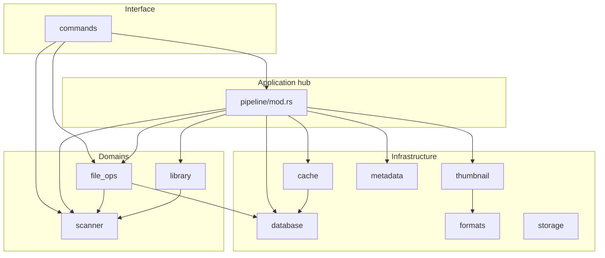

# Rust backend — комплексный архитектурный аудит

**Дата:** 2026-10-16  
**Область:** `src-tauri/src/` (40 файлов `.rs`, read-only)  
**Стандарт:** [`.cursor/rules/rust-backend-architecture.mdc`](../../.cursor/rules/rust-backend-architecture.mdc)  
**Канон IPC:** [`docs/IPC.md`](../IPC.md) (сверка с кодом — см. §4)

Production-код, пути модулей и Git-история **не изменялись** при подготовке отчёта.

---

## Участие субагентов

| Агент | Роль в аудите | ID сессии | Результат |
|-------|----------------|-----------|-----------|
| **architecture-coordinator** | Карта доменов, IPC-матрица, границы React↔Tauri, high-level roadmap | [06f39e3e-341b-4581-8b7a-13100c707531](06f39e3e-341b-4581-8b7a-13100c707531) | Согласован с проверкой по `lib.rs`, `commands/mod.rs` |
| **backend-decomposition** | God-modules, feature-first target layout, таблица перемещений, 6 этапов | [61bc17d5-6c16-4a43-9351-7b0a303825fd](61bc17d5-6c16-4a43-9351-7b0a303825fd) | Уточнены LOC и пути |
| **code-auditor** | Findings P0–P3, FS↔SQLite, session/generation | [3263dbbe-d662-4311-bc29-692023a4b09d](3263dbbe-d662-4311-bc29-692023a4b09d) | C1/C2 подтверждены чтением `pipeline/mod.rs`, `reconcile.rs` |
| **Оркестратор (текущая сессия)** | Сверка evidence, объединение, запись отчёта | — | Line counts, grep по событиям/зависимостям |

---

## 1. Резюме

Бэкенд StitchVue — **модульный монолит с плоской структурой по техническому типу** (`pipeline`, `file_ops`, `database`, `scanner`, …), а не feature-first по предметным областям. Циклических `mod`-зависимостей **нет** (граф компиляции ацикличен).

**Главные архитектурные долги:**

1. **`pipeline/mod.rs` (~3892 строк)** — сверхмодуль: session/generation, indexing, планировщик миниатюр, workers, watcher, emit событий, viewer/hover-оркестрация, обёртки favorites/trash, `execute_file_operation`, reconcile на старте.
2. **`file_ops/mod.rs` (~2738)** + **`file_ops/favorites.rs` (~2115)** — смешение generic FS, service folders, trash, favorites application.
3. **`Pipeline` как единый hub** — ~52 Tauri-команды в основном делегируют в `Pipeline`; application не отделён от thumbnail-runtime и `Mutex<Connection>`.
4. **Подтверждённые риски согласованности FS↔SQLite** при copy-to-favorites (см. §6, C1/C2) — продуктовый/технический долг, не только «косметика» структуры.

**Сильные стороны (оставлять при рефакторинге):** session/generation gates для metadata/thumbnail emit и `browse_directory`; temp+`move_noreplace` в copy; минимальный trait-слой (`IoGate`); плотное unit-тестовое покрытие в `file_ops`/`reconcile`/`favorites`.

---

## 2. Карта модулей и предметных областей

### 2.1. Текущая структура (факт)

```
src-tauri/src/
  lib.rs, main.rs          # composition root, 52 commands в generate_handler!
  commands/mod.rs          # IPC (~612 LOC)
  pipeline/                # application+infra hub
    mod.rs                 # ~3892 LOC
    viewer.rs, hover.rs    # viewer prefetch / folder hover
  scanner/                 # directory listing, drives, places, listing cache
  thumbnail/               # decode (jpeg, raw, heif, avif, …)
  metadata/, formats/      # EXIF / MIME
  cache/                   # thumbnail files + SQLite meta (~656 LOC)
  database/                # migrations + все таблицы (~891 LOC)
  file_ops/                # FS ops, favorites, trash, reconcile
  library/                 # recent/favorite folders, display_rotation
  storage/                 # HDD/SSD read profile
  window_anim/             # prototype window animation IPC
  bench.rs, fixtures.rs    # тесты/бенч
```

### 2.2. Сопоставление с предметными областями (стандарт §3.1)

| Предметная область | Текущие модули | Зрелость границы |
|-------------------|----------------|------------------|
| Gallery / directory | `scanner/*`, часть `commands`, `pipeline` (session, index) | Средняя: listing изолирован, сессия в pipeline |
| Indexing | `pipeline` (`index`, board), DTO `SourceFile` | Низкая: в god-module |
| Thumbnail pipeline | `pipeline`, `thumbnail/*`, `cache/`, `metadata/` | Низкая: всё сходится в `Pipeline` |
| Viewer | `pipeline/viewer.rs`, `pipeline/hover.rs` | Средняя: файлы отдельные, crate — pipeline |
| Favorites | `file_ops/favorites*.rs`, `pipeline` (links, execute) | Низкая: дублирование фасада |
| File ops / trash | `file_ops/mod.rs`, `recycle`, `trash_folder`, `reconcile` | Низкая: монолит mod.rs |
| Cache / persistence | `database/`, `cache/` | Средняя: один Connection в Pipeline |
| Library UI (folders) | `library/` | **Высокая** — почти изолирован |
| Storage profile | `storage/` | **Высокая** — маленький модуль |

### 2.3. Граф зависимостей (логический)



**Циклов между top-level модулями нет.** Архитектурная проблема — **звезда через `Pipeline`**, а не rustc cycle.

**Побочные связи:** `file_ops::invalidate_listing_caches` → `scanner::drop_listing_cache`; `library` использует DTO `scanner::FolderShortcut` (протекание DTO между доменами).

---

## 3. Слои: IPC / Application / Domain / Infrastructure

| Слой | Ожидание (стандарт) | Факт | Оценка |
|------|---------------------|------|--------|
| **IPC** | Тонкие commands, DTO, ошибки | `commands/mod.rs` в основном delegate; **исключения:** `browse_directory` эмитит `images-batch` + session gate; `run_file_operation` — claim/progress emit | Частичное нарушение §3.2 |
| **Application** | Сценарии, координация, отмена | `Pipeline`, `file_ops::execute`, `favorites.rs` | Сконцентрировано в 2–3 god-modules |
| **Domain** | Инварианты без Tauri/SQLite | `Action`, `StorageProfile`, path keys, classify в favorites — **фрагменты**, не выделенный слой | Pragmatic OK для малых кусков; не OK внутри 3k+ LOC |
| **Infrastructure** | FS, SQLite, decode | `database`, `cache`, `thumbnail`, `scanner`, `recycle` | Нормально, но `database` — монолит всех таблиц |

**Вывод:** для малых модулей (`storage`, `window_anim`, `formats`) плоская структура соответствует «pragmatic hexagonal». Для `pipeline` и `file_ops` — **нет**.

---

## 4. IPC и события (матрица)

**Команды:** 52 обработчика в `lib.rs` → `commands/*` (подсчёт `#[tauri::command]` в `commands/mod.rs`).

| Группа | Примеры commands | Слушатели / контракт (frontend) |
|--------|------------------|----------------------------------|
| Каталог / сессия | `browse_directory`, `begin_directory_session`, `start_indexing`, `reorder_indexing`, `set_*_range`, `set_scrolling`, `directory_accessible` | `images-batch` + session в payload |
| Pipeline / cache | `set_storage_profile`, `clear_cache`, `cache_usage`, `set_cache_*`, `pipeline_stats` | `metadata-batch`, `thumbnail-ready`, `thumbnail-failed` |
| Viewer | `prefetch_*`, `cancel_*`, `set_viewer`, `viewer_source`, `viewer_frame` | `viewer-frame-ready` (`pipeline/viewer.rs`, `ImageViewer.tsx`, `galleryHover.ts`) |
| Library | `list_subfolders`, `list_drives`, `remember_folder`, `toggle_favorite`, `recent/favorite_folders`, `folder_menu_*`, `rename_folder` | — |
| Favorites / trash | `favorite_origin_*`, `preview/remove_*`, `undo/discard_*`, `restore/recycle_*`, `describe_local_trash_*`, `trash_entry_origin` | — |
| File ops | `run_file_operation`, `cancel_file_operation` | `file-operation-progress` |
| Прочее | `resolve_external_drop`, `open_external_link`, `rotate_display_*`, `prototype_window_anim` | `window-anim-sample`, `window-anim-done` |

**Замечание (architectural concern):** в `docs/IPC.md` может отсутствовать полный перечень событий (`viewer-frame-ready`, `window-anim-done` подтверждены в коде). Рефакторинг **не должен** менять имена/payload без отдельного coordinator + IPC doc.

---

## 5. God-modules, смешение ответственности, циклы

| Модуль | LOC | Смешанные concerns | Приоритет декомпозиции |
|--------|-----|--------------------|-------------------------|
| `pipeline/mod.rs` | ~3892 | Scheduler, workers, indexing, watcher, events, DB lock, file ops orchestration, reconcile boot | **P0 structural** |
| `file_ops/mod.rs` | ~2738 | Copy/move, registry, service folders, trash paths, rename, progress | **P0 structural** |
| `file_ops/favorites.rs` | ~2115 | Classify, preview/remove, batch, undo flows | **P1** |
| `database/mod.rs` | ~891 | Migrations + все repos | **P2** (низкий риск при split API) |
| `commands/mod.rs` | ~612 | Все 52 commands в одном файле | **P3** (низкий риск split) |

**Циклические зависимости:** не обнаружены.  
**God-module hub:** `Pipeline` — единственная точка для thumbnail **и** favorites/trash/file_ops.

---

## 6. Углублённый анализ по областям

### 6.1. Session / generation

**Подтверждено:**

- `session: u64` — идентификатор с frontend; `begin_directory_session`, проверка в `browse_directory` (`commands/mod.rs` ~26–28).
- `generation` — инкремент при смене сессии/index/viewport; workers используют `generation_changed` / `live_session` перед emit (`pipeline/mod.rs` ~3127–3176, auditor C5).

**Риск рефакторинга:** **high** — любой перенос worker-логики должен сохранить порядок проверок до emit. Smoke: быстрое переключение папок; события старой session не применяются на UI.

### 6.2. Thumbnail pipeline + indexing

- Indexing: frontend → `start_indexing` → `pipeline.index` с `SourceFile[]`.
- Listing: `scanner/folder.rs`, `listing_cache.rs` (кэш каталогов).
- Decode: `thumbnail/*`; persist/evict: `cache/` + `database`.
- Viewer/hover: подмодули `pipeline/`, но логически отдельный runtime.

**Риск:** **high** (scheduler, приоритеты P0–P5, HDD slots через `storage`).

### 6.3. SQLite

- Один `stitchvue.db`, WAL; `Pipeline::Inner` держит `Mutex<Connection>` (auditor C3).
- Таблицы: thumbnail cache meta, image_meta, favorite_copies, trash, file_op_log, recent_folders, favorite_undo, …

**Риск split repos:** low–medium, если публичный API `database::` сохранён через re-exports.

### 6.4. Favorites

- Copy: `Action::CopyToLocalFavorites` → `file_ops::execute` → `Pipeline::record_operation_links` → `record_favorite_copy` / `finish_op`.
- Remove/preview/batch: `favorites.rs`; IPC почти всегда через `Pipeline`, хотя scheduler не нужен.

### 6.5. Filesystem safety

**Соответствует стандарту (подтверждено):**

- Copy: temp + atomic move pattern (`file_ops/mod.rs`, auditor C4).
- Path locks: `file_ops/locks.rs` (hypothesis H2: edge cases с `\\` в ancestor check).

**Подтверждённые дефекты согласованности (auditor):**

| ID | Severity | Суть | Evidence |
|----|----------|------|----------|
| **C1** | P1 confirmed | Pending op для favorites создаётся с `destination_path: None`; после сбоя между FS-copy и `finish_op` reconcile для `OP_ADD_TO_FAVORITES` не восстанавливает связь по dest | `pipeline/mod.rs` ~967; `reconcile.rs` ~72–106 |
| **C2** | P1 confirmed | FS copy успешен, `record_favorite_link` Err → outcome `failed`, файл остаётся в избранном | `pipeline/mod.rs` ~857–887 |
| **C3** | P2 confirmed | Общий `Mutex<Connection>` для file ops и thumbnail workers | `pipeline/mod.rs` ~233, ~953 |

**Рекомендация:** закрыть C1/C2 **отдельными high-risk TASK** до или параллельно структурному рефакторингу; не маскировать переносом файлов.

### 6.6. Reconcile / boot

- `Pipeline::start` → `reconcile_on_boot` (`reconcile.rs`): unfinished ops + legacy favorite_undo.
- Семантика partial failure: `ST_NEEDS_RECONCILIATION` — не атомарность FS+DB.

---

## 7. Целевая структура (feature-first, без обязательных 4 слоёв)

Принцип: **предметная папка + плоские файлы**, подпапки `application/` / `domain/` / `infrastructure/` только где вырастет сложность (favorites, trash, thumbnails).

```
src-tauri/src/
  app/                         # lib.rs setup, State wiring (опционально)
  ipc/commands/                # thin handlers по доменам
  shared/                      # formats, storage, path_key, общие DTO
  gallery/                     # scanner → folder, places, listing_cache
  thumbnails/                  # scheduler, board, workers, generation
    decode/                    # бывший thumbnail/
    cache/                     # бывший cache/
    metadata/                  # или shared/metadata при dual-use
  viewer/                      # frame + hover
  favorites/                   # copy link, remove, batch, classify
  trash/                       # local trash, recycle, restore, reconcile
  file_ops/                    # generic execute, copy, registry (без favorite policy)
  library/                     # без изменений смысла
  persistence/                 # migrate + repos по таблицам
  window_anim/                 # без изменений
```

На переходном периоде — **`pub use` re-exports** из старых путей (`crate::scanner` → `crate::gallery`) до удаления совместимости.

---

## 8. Таблица перемещений (существующие файлы)

| From | To (целевой) | Этап | Risk |
|------|----------------|------|------|
| `commands/mod.rs` | `ipc/commands/{gallery,thumbnails,favorites,trash,file_ops,library,viewer,window}.rs` | R1 | low |
| `scanner/folder.rs` | `gallery/folder.rs` | R2 | low |
| `scanner/places.rs` | `gallery/places.rs` | R2 | low |
| `scanner/listing_cache.rs` | `gallery/listing_cache.rs` | R2 | low |
| `scanner/mod.rs` | `gallery/mod.rs` | R2 | low |
| `pipeline/viewer.rs` | `viewer/frame.rs` | R3 | medium |
| `pipeline/hover.rs` | `viewer/hover.rs` | R3 | medium |
| `thumbnail/*` | `thumbnails/decode/*` | R4 | medium |
| `cache/mod.rs` | `thumbnails/cache/mod.rs` | R4 | medium |
| `metadata/mod.rs` | `thumbnails/metadata/mod.rs` (или `shared/metadata`) | R4 | medium |
| `pipeline/mod.rs` (scheduler, board, workers, indexing) | `thumbnails/{board,scheduler,workers,indexing,session}.rs` | R5 | high |
| `file_ops/favorites.rs` | `favorites/remove.rs` (+ splits) | R6 | high |
| `file_ops/favorites_batch.rs` | `favorites/batch.rs` | R6 | high |
| `file_ops/favorites_lifecycle.rs` | `favorites/lifecycle_test.rs` / интеграция в tests | R6 | high |
| `file_ops/recycle.rs` | `trash/recycle.rs` | R6 | high |
| `file_ops/trash_folder.rs` | `trash/folder.rs` | R6 | high |
| `file_ops/reconcile.rs` | `trash/reconcile.rs` | R6 | high |
| `file_ops/mod.rs` (core execute) | `file_ops/{execute,copy,registry}.rs` | R7 | high |
| `database/mod.rs` | `persistence/{migrate,settings,recent,favorites_repo,trash_repo,thumb_repo}.rs` | R2b | low–medium |
| `library/*` | `library/*` (rename only if needed) | — | low |
| `formats/*`, `storage/*` | `shared/formats`, `shared/storage` | R2c | low |
| `window_anim/*` | без перемещения | — | — |

Файлы **`content_hash.rs`, `locks.rs`, `fav_metrics.rs`, `favorites_bench.rs`** — оставить рядом с потребителем до стабилизации границ favorites/file_ops.

---

## 9. Roadmap (низкий → высокий риск)

| Этап | ID | Цель | Зависимости | Автопроверки | Ручной smoke (обязательный) |
|------|-----|------|-------------|--------------|------------------------------|
| 0 | **FIX-C1C2** | FS↔SQLite: destination в pending op; компенсация при link failure | — | `cargo test` reconcile, favorites_lifecycle fixtures | copy-to-favorites; kill после copy; reboot/reconcile |
| 1 | **R1** | Split `commands/` по доменам, без смены `generate_handler!` имён | — | `cargo check`, `npm run typecheck` | smoke invoke ключевых команд |
| 2 | **R2** | `scanner` → `gallery/` + re-export | R1 опционально | `cargo test scanner` → gallery | browse, list drives, folder switch |
| 2b | **R2b** | Split `database/` migrate/repos, stable pub API | — | migrate roundtrip tests | cache settings, favorites list |
| 2c | **R2c** | `formats`/`storage` → `shared/` | — | unit tests formats | storage profile toggle |
| 3 | **R3** | Extract `viewer/` из pipeline | R1 | viewer.rs tests | open viewer, prefetch, scroll |
| 4 | **R4** | `thumbnail`+`cache`+`metadata` под `thumbnails/` | R3 желательно | thumbnail/cache tests | scroll thumbs, cache clear |
| 5 | **R5** | Split scheduler/indexing из `pipeline/mod.rs` | R4 | generation stale unit tests | fast folder switch, 50k scroll sample |
| 6 | **R6** | `favorites/` + `trash/` application; убрать лишние делегаты Pipeline | R5, FIX-C1C2 | favorites + reconcile tests | favorite add/remove/undo; trash restore |
| 7 | **R7** | Утончить `file_ops` + `DiskGate`/DB hooks; развязать mutex (C3) | R6 | partial failure tests | copy during scroll |

**Маршрут TASK_HANDOFF:** R1–R2c → low/medium; R3–R5 → medium/high (guardian + smoke); R6–R7, FIX-C1C2 → **high** (auditor до правок, guardian, smoke).

**Rollback:** один этап = один (или связанный) TASK, `base_commit` зафиксирован; re-exports позволяют откатить без IPC change.

---

## 10. Модули, которые лучше не трогать (в первых этапах)

| Модуль | Причина |
|--------|---------|
| `window_anim/` | Изолированный prototype IPC; нет пересечения с gallery/thumbnails |
| `bench.rs`, `fixtures.rs` | Только тестовая инфраструктура |
| `storage/mod.rs` | Маленький, стабильный профиль HDD/SSD |
| `formats/mod.rs` | Cross-cutting, без бизнес-сценариев |
| `library/` | Уже компактный; минимальная связь со scanner DTO |
| `file_ops/locks.rs`, `content_hash.rs` | Узкие утилиты с тестами; перенос только вместе с потребителем |

**Не означает «никогда»** — только низкий ROI на ранних этапах.

---

## 11. Umbrella-контракт: оценка

**Вопрос:** один umbrella TASK с автономными внутренними этапами?

**Вывод:** **координация через umbrella — да; единый sealed TASK на весь рефакторинг — нет.**

Причины (см. [`TASK_HANDOFF.md`](TASK_HANDOFF.md)):

1. После `--seal` нельзя менять §2–§4; umbrella с десятками `allowed_paths` и разным риском быстро устаревает.
2. **High** этапы (R5–R7, FIX-C1C2) требуют отдельного auditor/guardian/smoke цикла.
3. `approval_hash` привязан к конкретному scope; смешение low и high в одном контракте повышает риск занижения risk.

**Рекомендуемая схема:**

- **Umbrella-документ** (этот файл + опционально `TASK-RUST-UMBRELLA` со `status: draft|in_progress`, scope только `docs/refactoring/**`, §7 — чеклист этапов R1…R7).
- **Дочерние TASK** `TASK-RUST-R1`, … с узким `allowed_paths`, своим `risk`, `base_commit` на входе этапа.
- В §1 дочерних задач — поле `parent: RUST_ARCHITECTURE_AUDIT` / `depends_on: FIX-C1C2`.

Так исполнители остаются **автономными**, guardian проверяет **локальный diff**, coordinator синхронизирует только IPC при необходимости.

---

## 12. Приоритеты и риски (сводка)

| Приоритет | Тема | Тип | Действие |
|-----------|------|-----|----------|
| 1 | C1, C2 favorites FS↔DB | confirmed defect | FIX-C1C2 TASK (high) |
| 2 | `pipeline/mod.rs` decomposition | architectural | R3–R5 |
| 3 | Favorites/trash отвязка от Pipeline | architectural | R6 |
| 4 | `commands` / `gallery` rename | structural low risk | R1–R2 |
| 5 | C3 DB mutex | performance/concurrency | R7 или отдельный perf TASK |
| 6 | A3 feature-first layout | architectural | постепенно с R2–R6 |
| 7 | IPC doc vs `viewer-frame-ready` | docs | docs-sync, не Rust refactor |

**Инварианты не менять без ТЗ:** имена commands/events, session/generation semantics, scheduler priorities, copy/move/trash/favorites semantics, SQLite schema/migrations.

---

## 13. Рекомендуемый порядок реализации

1. Утвердить этот аудит как baseline roadmap.
2. **FIX-C1C2** (high) — продуктовая целостность избранного.
3. **R1 → R2 → R2b** — низкий риск, улучшают навигацию по коду без смены поведения.
4. **R3 → R4 → R5** — thumbnail/viewer; строгий smoke scroll + folder switch.
5. **R6 → R7** — favorites/trash/file_ops; только после стабилизации pipeline core.
6. Параллельно: синхронизировать `docs/IPC.md` с фактическими events (read-only doc task).

---

## 14. Противоречия и ограничения аудита

- **Нет противоречия** с `fsd-decomposition.mdc`: FSD только для frontend.
- **UNVERIFIED:** полнота reconcile для всех `op_type` под crash-сценариями; race file watcher vs file_ops (нужны интеграционные тесты на temp dir).
- **Не измерялось:** влияние `Mutex<Connection>` на FPS при больших каталогах.
- Subagent LOC округлялись; в отчёте для ключевых файлов использованы фактические подсчёты строк (PowerShell) на дату аудита.

---

*Конец отчёта. Следующий шаг — создать `docs/refactoring/tasks/TASK-RUST-R1.md` (или FIX-C1C2) по [`TASK_TEMPLATE.md`](TASK_TEMPLATE.md) с узким scope.*
